  

Personal portfolio site of eternalDev, a web developer in Switzerland. It shows pinned projects, three case study pages, an about page, a contact page, and a privacy policy.

This is my first web project ever built. It was made to learn the fundamentals of HTML, CSS, and layout from scratch, without a framework.

The site is a static build of plain HTML and CSS. There is no framework, no package manager, no build step, and no JavaScript.

## Pages

* index.html: Home, with the pinned projects and a short about section
* project-page.html: Overview of all projects
* projects-pages/portfolio-project.html: Case study, portfolio site
* projects-pages/design-project.html: Case study, design showcase
* projects-pages/fuelsplit-project.html: Case study, FuelSplit fuel strategy calculator
* about-page.html: About page
* contact-page.html: Contact page with contact form and external links
* privacy-policy.html: Privacy policy

## Structure

    index.html
    about-page.html
    contact-page.html
    project-page.html
    privacy-policy.html
    projects-pages/     case study pages
    css/                base, components, projects, and one stylesheet per page
    assets/logo/        favicons, app icons, logo SVGs, web manifest
    assets/fonts/       Geist Mono and Plus Jakarta Sans, with OFL license texts
    assets/Icons/       SVG icons for the tech stack and social links
    assets/Projects/    project screenshots in PNG and WebP at 700px and 1050px
    assets/about_me/    portrait images in several sizes

## Stack

* HTML5
* CSS, split into a base file, a components file, a projects file, and one file per page
* CSS only lightbox on the design showcase, built with a checkbox and the :checked selector
* Self-hosted fonts: Geist Mono for monospace text, Plus Jakarta Sans for body text
* SVG icons, and responsive images in WebP and PNG

## Design tokens

Defined as CSS custom properties in css/base.css:

* Background: #0d0e0e
* Light background panel: #121313
* Text: #eaeaea
* Accent orange: #fe3a00
* Accent blue: #1e90ff
* Accent green: #5f9ea0

## Contact

info@eternaldev.ch

Social links on the site: Discord, X, Instagram, and GitHub.

## License

No license file was found in this repository. The fonts in assets/fonts are under the SIL Open Font License, and their license texts are included.
